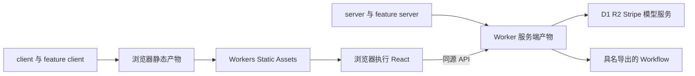
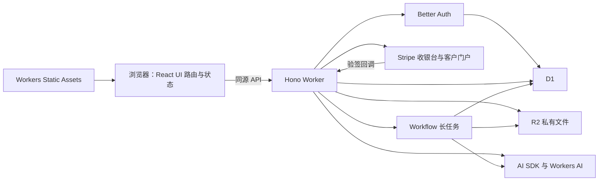

# 少配置应用模板完整方案

> 用户已批准第二阶段变更：[app-starter / Supabase Auth 修订](../specs/2026-10-17-phase-two-auth-amendment.md)。第二阶段以此修订为准；历史 CPU 证据不变。
日期：2026-10-17

状态：已批准的设计基线。先执行[实施计划](../plans/2026-10-17-cloudflare-app-starter-implementation-plan.md)中的三项可行性验证，通过后再搭建模板。

2026-10-17 执行调整：用户明确允许暂时跳过缺少凭据的 Stripe Sandbox 云验证；支付保持“尚未验证”，豁免范围与门禁记录在实施计划及 `docs/validation/approved-exceptions.json`。Cloudflare、CPU/模型和恢复门槛保持不变。

本方案面向快速验证新应用：前端、认证、支付、数据和 Agent 采用固定默认组合，一处应用配置、一套发布流程。基础设施优先使用免费额度；完整应用按 Workers Paid 每账户每月 5 美元起预留预算，模型、资源超额、邮件和支付费用另计。免费额度是验证路径，不是完整系统永久免费运行的承诺。

## 1 目标

交付一套独立应用模板。创建新应用时，开发者填写应用名称、选择 Web 或 Agent 类型，运行同一个部署命令，即可得到可访问的应用。数据库、文件存储、认证密钥、环境和任务绑定由模板处理；需要收款时再增加套餐和支付密钥，支付初始化并入同一流程。

novel-writer 提供成熟的 UI、权限、Prompt、工具调用、用量控制和故障处理经验。模板与 novel-writer 独立维护，不迁移原产品，不要求兼容它的模块、数据库、接口或部署结构。

第一版同时交付普通 Web 与 Agent 应用的完整示例，支付和权益属于两者共用的必备能力。配置负责品牌、套餐、功能启用和运行参数；新业务的页面、数据模型、Prompt 和工具仍由开发者编写。

## 2 推荐的一套默认技术栈

本方案推荐 Cloudflare 原生组合，减少首次配置的平台数量。数据库和认证采用下面这一套实现，不同时维护 Supabase 与 D1 两套版本。

| 部分 | 默认选择 | 开发者需要处理的内容 |
| --- | --- | --- |
| 页面 | React、Vite、TypeScript | 修改业务页面和品牌 |
| UI | shadcn/ui、Radix、Tailwind CSS | 复用模板组件，按业务调整样式 |
| 路由与数据 | React Router、TanStack Query | 增加页面、查询与写入操作 |
| 表单与界面状态 | React Hook Form、Zod；Zustand 按需 | 编写业务表单及少量共享界面状态 |
| 国际化与反馈 | react-i18next、Sonner、Lucide | 默认中英文、通知和统一图标 |
| API | Hono | 新增业务接口 |
| 部署 | Cloudflare Workers、官方 Vite plugin、Wrangler | 首次连接 Cloudflare 账户 |
| 认证 | Better Auth | 默认邮箱密码登录；角色与会话配置由模板提供 |
| 支付 | Stripe Checkout、Customer Portal | 开通商户账户、提供密钥、设置价格与权益 |
| 数据库 | D1、Drizzle | 修改业务 schema，生成迁移 |
| 文件 | 私有 R2 bucket | 通过模板的文件接口使用 |
| Agent | AI SDK、Workers AI、assistant-ui | 修改 Prompt、工具、模型及聊天交互 |
| 长任务 | Cloudflare Workflows | 业务需要时增加步骤，绑定随 Agent 配置自动启用 |

前端静态资源和 API 作为一个 Worker 一起部署。Workflow 类由同一份 Worker 代码导出，无需独立后台服务器。普通 Web 配置不启用模型调用和 Workflow 资源。

React SPA 与 Hono API 的单 Worker 组合已有官方模板。Better Auth 支持 D1；Workers AI 可以通过 AI SDK 的适配器使用。[Cloudflare 全栈指南](https://developers.cloudflare.com/workers/framework-guides/web-apps/more-web-frameworks/hono/)、[Better Auth D1 支持](https://better-auth.com/blog/1-5#cloudflare-d1-support)、[Workers AI 与 AI SDK](https://developers.cloudflare.com/workers-ai/configuration/ai-sdk/)

默认采用 React SPA，适合工作台、工具、管理系统和 Agent 应用。需要复杂 SSR 或大量 SEO 页面时，在具体应用中再选择相应方案，不要求所有验证项目先承担服务端渲染的配置。

## 3 前端默认能力

### 组件与页面

组件采用 shadcn/ui 的 Radix 版本，复用 novel-writer 已有的通用组件和交互经验。固定基础实现、生成器选项和依赖版本，模板发布时验证组合，不在创建新应用时重新选择组件体系。shadcn 当前新项目默认 Base UI，Radix 仍受支持；这里选择 Radix 是为了降低已有组件的复用成本。[组件基础选择](https://ui.shadcn.com/docs/changelog/2026-07-base-ui-default)

默认提供按钮、输入框、表单、对话框、菜单、标签页、卡片、侧栏、分页、通知，以及加载、空状态、错误、无权限和确认操作。应用布局支持移动端、深浅主题和键盘操作。图表、富文本编辑器和大型编辑工作台按具体业务增加。

| 页面集合 | 第一版提供的内容 |
| --- | --- |
| 公共页面 | 应用介绍、登录、邀请接受、套餐、支付返回页 |
| 应用工作台 | 业务记录列表、搜索、分页、创建、编辑、删除、私有文件 |
| 个人与支付 | 资料、密码、用量、订阅、订单、客户门户入口 |
| 管理页面 | 用户、运行、用量、订单、订阅和受保护的恢复操作 |
| Agent 页面 | 会话列表、流式聊天、工具确认、任务进度、结果下载 |

### 路由

采用 React Router 客户端 Data 模式，提供公共布局、登录后的应用布局和管理布局，统一处理导航、加载、错误与 404。页面使用显式懒加载，保持当前 SPA 部署方式。路由入口集中注册，功能页面放在对应 feature 的 `client` 中。[React Router 模式](https://reactrouter.com/start/modes)

URL 保存筛选、分页、选中记录和会话 ID，支持刷新、后退和分享。前端登录保护用于导航体验，后端继续验证会话、角色和资源归属。公开注册、验证邮件和密码重置页面仅在相应注册模式启用。

### 状态职责

| 状态 | 默认归属 |
| --- | --- |
| 筛选、分页、当前会话或任务 ID | React Router 的 URL 参数 |
| 记录、文件、订单、订阅、权益、后台任务快照 | TanStack Query |
| 登录与会话 | Better Auth 客户端会话状态 |
| 表单输入、字段错误、提交状态 | React Hook Form 与 Zod |
| 单个组件的展开、弹窗、临时选择 | React `useState` 或 `useReducer` |
| 确有多个组件共同使用的临时界面状态 | 按 feature 建立的 Zustand store |
| 正在输出的消息、工具交互、聊天运行状态 | assistant-ui 的 AI SDK runtime |

TanStack Query 负责远端数据缓存；Zustand 仅承接必要的客户端共享状态。账号资料可以进入 Query，但不能再维护另一套“是否登录”状态。角色、付费权益和余额始终以服务端为准。登出或切换账号时清理该账号的查询缓存、聊天和临时状态。[Query 职责](https://tanstack.com/query/latest/docs/framework/react/overview)、[Zustand](https://zustand.docs.pmnd.rs/learn/getting-started/introduction)

### 请求与更新

业务请求使用一个基于 `fetch` 的薄客户端，统一同源 `/api`、错误格式、取消信号与会话失效处理。每个 feature 定义 query key、查询函数和写操作；路由 loader 如需预取，通过同一 QueryClient 操作，页面订阅同一缓存，避免再用独立 `useEffect` 重复取数。

模板统一设置缓存时间、重试及轮询策略：普通业务数据默认保持新鲜 60 秒，写入成功后按 query key 主动失效；任务和支付结果使用各自的刷新条件。普通读取最多自动重试一次，401/403 不自动重试；创建 Checkout、启动任务、确认修改等写操作默认不自动重试，手动重试沿用业务幂等键。Query 的刷新和重试行为由模板明确配置，不能直接依赖库默认值。[Query 默认行为](https://tanstack.com/query/latest/docs/framework/react/guides/important-defaults)

后台任务仅在页面可见且任务未到终态时轮询，初始间隔 5 秒；完成、取消或失败后停止，返回页面时重新查询。聊天 token 由 runtime 更新，不逐个触发 Query 刷新或后端写入。生成完成后再刷新受影响的业务查询。付费操作是否允许执行仍由服务器实时检查。

支付返回页通过后端查询订单处理结果，默认最多自动等待 60 秒；确认同步后刷新订单、订阅和权益缓存。不能依据 URL 参数、跳转成功或创建 Checkout 成功更新付费权限。等待超时停止自动查询，显示可刷新和联系管理员的信息，不将仍在处理的支付改判为失败；管理员可使用支付对账入口。

### 表单、国际化与 Agent 界面

React Hook Form 与 Zod 统一处理输入、字段校验、提交和服务端错误；前后端可共享纯参数 schema，服务端仍独立校验。react-i18next 默认提供中英文，复用文案组织方式，去掉 Next.js 专属依赖。[表单校验集成](https://github.com/react-hook-form/resolvers)、[react-i18next](https://react.i18next.com/)

Agent 使用 assistant-ui 官方 AI SDK 适配，提供消息、Markdown、流式输出、工具卡片和确认界面；会话、工具结果与业务状态通过本应用的 API 持久化到 D1。复用现有组件经验，重新编写薄适配，不搬入小说专用的大型 runtime，也不要求外接聊天托管服务。[assistant-ui AI SDK 接入](https://www.assistant-ui.com/docs/runtimes/ai-sdk/overview)

这些选择固定在模板内，不增加 Wrangler bindings、平台账号、独立前端域名或部署步骤。新应用主要修改品牌、菜单、页面、表单和查询逻辑。

## 4 打包与运行边界

`features` 按业务组织代码，目录名不决定执行位置。每个功能明确区分 `client`、`server` 与 `shared`；Vite 从浏览器和 Worker 入口分别沿 import 依赖图构建。[Vite 构建环境](https://developers.cloudflare.com/workers/vite-plugin/reference/vite-environments/)

| 源码 | 部署产物 | 执行位置 |
| --- | --- | --- |
| `src/client`、`features/*/client` | 浏览器 JS、CSS、HTML 和页面分块 | 用户浏览器 |
| `src/server`、`features/*/server` | Worker 服务端代码 | Cloudflare Workers |
| Agent 服务端中的 Workflow 类 | 同一 Worker 的具名导出与 Workflow 绑定 | Cloudflare 管理的独立任务执行 |
| `shared` 中的纯类型、参数 schema、事件结构 | 按实际引用进入对应产物；纯类型会被移除 | 引用它的一侧 |

一次部署上传静态资源和 Worker 服务端代码。浏览器加载前端资源并请求 `/api`，Hono 执行服务器逻辑；import 一个后端函数不会自动变成远程调用。Workflow 随同一代码版本发布，不依赖维持某个 HTTP 请求来执行任务。



### 依赖约束

1. `client` 禁止引用 `server`；`shared` 不能依赖任何服务端模块。不要建立混合导出两侧代码的 feature 总入口。
2. 数据库接入、Drizzle 表定义、Stripe 服务端 SDK、模型 binding、私有 Prompt、工具执行和 Workflow 只允许由服务端入口引用。共享表单参数不是共享数据库实现。
3. 只向客户端导出显式允许公开的品牌与界面配置，不整份导入服务端配置。secret 仅通过 Worker bindings 获取，不放进 `VITE_*` 或浏览器存储。
4. 文件命名和 tree shaking 不能代替边界约束。类型检查、导入规则和客户端产物检查共同拒绝越界依赖。

### 页面分块与功能裁剪

基础工作台与 Agent 页面分块加载，进入聊天页面才加载对应的聊天 UI 与渲染代码。Web/Agent 的入口和资源绑定在构建前由 `preset` 确定；Web 构建不引用 Agent 页面和服务端模块，也不导出 Workflow 类，Agent 构建在公共入口基础上增加它们。

前端懒加载不等于服务端已被裁剪，验收分别检查客户端 chunk、Worker 导出和 bindings。两种配置共用源码与部署脚本，只保留少量预置入口，不形成两个独立应用。

已上线 Agent 切回 Web 前，先关闭新运行入口，再完成或取消已有运行，处理剩余投递和用量结算。部署检查确认无未终态运行和待处理任务事件后才允许移除 Agent 入口；未满足时拒绝切换并保留现有版本。切换不删除原有数据或云资源。

静态页面与资源优先由 Static Assets 返回，`/api` 与 `/api/*` 通过 `assets.run_worker_first` 的路径规则明确进入 Worker；SPA 深链接刷新返回前端入口。未知 API 返回 JSON 错误，不能落入 HTML fallback。需要按请求执行服务端鉴权的操作全部通过 API，不把私有数据放入公开静态文件。[Worker 与静态资源路由](https://developers.cloudflare.com/workers/static-assets/routing/worker-script/#run-worker-first-for-selective-paths)

## 5 新应用的使用方式

以下配置和 npm 命令是模板需要交付的使用接口，尚不是当前仓库已经存在的脚本。

不启用收款时，新应用只需要填写下面三个字段；支付能力仍随模板交付：

```ts
// app.config.ts
export default {
  slug: "my-app",
  title: "我的应用",
  preset: "agent", // "web" 或 "agent"
};
```

`slug` 决定应用及其资源的名称，首次部署后保持稳定。`title` 可以随时修改。`preset` 选择同一模板中的功能集合，不能因为重新部署就清空另一集合已经生成的数据。

本地需要模板声明的 Node.js 与 npm 版本。命令通过 Node 脚本兼容 PowerShell、macOS 与 Linux，不要求手工设置 Shell 环境变量。

使用过程：

1. 从模板创建自己的仓库，安装锁定的依赖。
2. 填写上述配置，运行本地应用。
3. 首次部署时连接 Cloudflare，按引导完成账户准备。
4. 部署成功后打开地址，完成一次管理员设置，即可邀请测试用户使用。

```bash
npm ci
npm run dev
npm run deploy:dev
npm run deploy:prod
```

日常修改后的发布仍使用同一条目标环境命令。开发者不需要自行复制数据库 ID、维护两个后端进程、配置跨域或逐个绑定任务资源。

模型、单次调用上限、文件大小、注册方式和自定义域名都有模板默认值，只在应用确实需要时修改同一处配置。密钥不放入这份公开配置。

启用收款时，在同一份配置中增加价格和权益。例如：

```ts
billing: {
  enabled: true,
  currency: "usd",
  monthly: { amountMinor: 990, credits: 1000 },
  creditPack: { amountMinor: 490, credits: 500 },
}
```

金额使用货币最小单位整数；以上数字只展示配置形式。第一版采用单币种，套餐可授予功能权限及应用用量额度。开发者不手填 Stripe Product、Price 或 webhook ID。支付配置是收款时必要的新增项，不能把收费应用也描述为只填三个字段即可上线。

## 6 首次需要准备什么

### Cloudflare 账户

首次在本机授权 Cloudflare；有多个账户时明确选择目标账户。使用文件功能需要先在 Cloudflare 控制台开通 R2，自动创建 bucket 不能替代账户开通。[R2 开通说明](https://developers.cloudflare.com/r2/get-started/)

默认使用平台提供的 `workers.dev` 地址，自定义域名不是首次发布的前置条件。绑定自己的域名时，再添加域名配置并完成必要的 DNS 授权。

### 认证和管理员

默认采用邀请测试模式，关闭公开注册。首次发布生成有时效、一次性的管理员设置入口，由用户设置邮箱和密码；完成后入口失效。后端通过持久化完成标记和令牌校验保护初始化，不能采用“第一个注册的人自动成为管理员”。

管理员可创建测试用户或生成有期限的邀请链接。邀请测试模式不依赖外发邮件；管理员提供受保护的账号恢复操作。密码由 Better Auth 正常处理，不直接向数据库写入明文密码。

需要开放注册时，切换为公开模式并配置默认邮件供应商 Resend 的 API key、已验证发件地址。此时启用邮箱验证和密码重置；缺少邮件配置则阻止公开模式上线。OAuth 作为后续可选登录方式，不是首次运行的必填项。

`BETTER_AUTH_SECRET` 按环境自动生成并保存为 Worker secret。重复部署复用原值，不能每次生成新值导致会话失效。应用始终从服务端验证会话和资源归属，客户端无法修改管理员角色。

### 模型

Agent 配置默认通过 Cloudflare `AI` binding 使用 Workers AI，不需要新建另一个模型供应商账号或手填模型 API key。模板提供一个支持流式和工具调用的默认模型，模型 ID 只在一处配置维护。

初始可验证模型为 `@cf/meta/llama-3.3-70b-instruct-fp8-fast`；在模板发布验收中验证其工具调用、输出格式和实际用量后锁定。它用于通用示例，具体业务依据效果调整模型。[模型说明](https://developers.cloudflare.com/workers-ai/models/llama-3.3-70b-instruct-fp8-fast/)

第一版默认实现这一条模型接入，不搭建通用模型路由平台。有外部模型需求时，在具体应用中增加 AI SDK provider 和对应 secret，不影响账号、数据库和部署方式。

### 支付账户

默认接入 Stripe，借鉴 novel-writer 的支付、订阅和权益处理经验，不兼容原产品的套餐或订单。商户开户及正式收款激活由应用所有者完成；模板不代办开户，也不自动迁入原产品的支付账户或密钥。

每个环境通过安全提示或 secret 命令提供 `STRIPE_SECRET_KEY`。支付初始化流程创建或复用应用自己的商品、价格、客户门户配置和 webhook endpoint，首次生成的 `STRIPE_WEBHOOK_SECRET` 自动保存为 Worker secret。重复部署不重建已关联对象、不轮换签名密钥；遗失密钥时明确引导修复，不能将未知 endpoint 当作已配置。

商品和价格按应用、环境、套餐及价格版本映射。改价创建新 Price，历史订单保留原价格与权益快照，已有订阅不自动改价或批量补扣。默认使用 Stripe 托管收银台，前端不采集银行卡信息，也不要求额外填写 publishable key。[Stripe Checkout](https://docs.stripe.com/payments/checkout)、[Webhook endpoint API](https://docs.stripe.com/api/webhook_endpoints/create)

## 7 一个应用和两种配置



两种配置共用布局、用户、权限、数据、文件、支付、管理页和部署命令。Agent 配置只在这一基础上增加业务能力。

| 能力 | Web 配置 | Agent 配置 |
| --- | --- | --- |
| 登录、用户、资料与基本管理 | 包含 | 包含 |
| 示例业务记录的列表、创建、编辑、删除、分页 | 包含 | 包含 |
| 私有文件上传、下载和删除 | 包含 | 包含 |
| 角色和资源归属校验 | 包含 | 包含 |
| 套餐页、一次性购买、月订阅与支付记录 | 包含，可关闭收款 | 包含，可关闭收款 |
| 客户门户、订阅状态、取消与权益同步 | 包含 | 包含 |
| 聊天、历史、流式回答与停止 | 不启用 | 包含 |
| 读取工具、确认后执行的修改工具 | 不启用 | 包含 |
| 多步骤任务、等待确认、取消、失败恢复 | 不启用 | 包含 |
| 调用次数、token、并发和用量上限 | 不启用 | 包含 |

第一版用“记录与文件管理”验证普通应用，用“整理资料并生成报告”验证 Agent。Agent 示例必须真正读写业务记录、等待用户确认，并通过 Workflow 生成可下载结果；不以聊天页面代替完整 Agent 验收。

不预装独立管理后台、Redis、WebSocket、多 Agent 集群、多租户组织、RAG 或插件系统。管理页面在同一应用内；实时输出使用 HTTP 流；长任务状态通过 API 查询。第一版只接一个支付供应商，不同时实现多渠道支付或全球多币种定价。

## 8 本地开发和正式环境

| 环境 | 数据与文件 | 模型 | 使用方式 |
| --- | --- | --- | --- |
| 本地 | 本地 D1 和 R2 模拟资源 | 默认确定性模拟，可显式切换真实 Workers AI | `npm run dev`，不要求 Docker |
| 云开发 | 独立 dev Worker、D1、R2 和 Workflow | 真实调用，独立应用用量限制 | `npm run deploy:dev` |
| 云正式 | 独立 prod Worker、D1、R2 和 Workflow | 真实调用，独立应用用量限制 | `npm run deploy:prod` |

本地模拟模型显示明确标记，方便无网络、无云授权时开发 UI 和业务。启用本地真实模型需要 Cloudflare 授权，并消耗账户额度。云端 Agent 冒烟必须实际调用模型，不能以模拟回答判定通过。

支付同样隔离：本地可使用明确标记的供应商替身；云 dev 连接 Stripe Sandbox/测试环境，云 prod 连接正式收款环境。Customer、商品、价格、订单、订阅、webhook 和密钥均按环境隔离，禁止测试事件发放正式权益。首次支付验收使用 Stripe 测试交易；正式部署不自动发起真实扣款。[Stripe 测试环境](https://docs.stripe.com/testing)

资源名称统一由应用名与环境生成，例如 `my-app-dev` 和 `my-app-prod`。数据库、文件、认证 secret、邀请、任务实例和管理员均隔离；同一个邮箱在两个环境中也是不同账号。每个环境独立迁移，不复制 dev 用户或文件到 prod。

资源隔离不代表免费额度翻倍。同一 Cloudflare 账户下的 dev、prod 和其他应用共用相应账户额度；云开发的模型调用、查询和 Workflow 步骤同样计入用量。

Worker bindings、认证 Origin 和部署地址按目标环境自动配置；业务 API 使用相对路径，前端不再维护另一套 API 域名。公开配置进入构建产物，secret 只注入运行环境。

模板在 Vite 构建前选择目标环境。Cloudflare Vite plugin 的 `CLOUDFLARE_ENV` 在 dev/build 阶段生效，仅在最终部署时切换环境不足以改变已构建的目标。[Vite 环境选择](https://developers.cloudflare.com/workers/vite-plugin/reference/cloudflare-environments/)

## 9 部署命令负责的工作

部署脚本只组合原生 Wrangler 命令与项目检查，不开发自有 IaC 状态系统、资源控制台或新部署框架。原生配置保留在仓库，错误输出可以追溯到具体步骤。

| 顺序 | 自动处理内容 | 失败时行为 |
| --- | --- | --- |
| 1 检查 | 读取应用配置，确定 account、环境、preset 入口、Worker 名称和启用能力，执行类型及依赖边界检查 | 缺失值明确报错，目标不匹配时停止 |
| 2 准备资源 | 检查或创建 D1，写回源配置；准备启用功能的绑定 | 已有资源重复使用，不按每次部署新建 |
| 3 构建 | 选择目标环境和功能入口，根据绑定构建客户端、页面分块和 Worker，检查产物边界 | 构建失败不执行远程迁移，已创建资源保留供重试 |
| 4 迁移 | 对目标 D1 应用已提交的待执行 migration | 失败停止上线，不运行 reset 或演示 seed |
| 5 配置凭据 | 创建或复用认证 secret，检查支付、可选邮件等配置 | 收款已启用但支付密钥缺失时停止；不输出明文 secret |
| 6 发布 | 上传静态资源与 Worker；原生创建缺失 R2、配置 Workflow | 报告失败步骤，保留资源关系供重试 |
| 7 支付初始化 | 已启用时，同步 Stripe 商品、价格、客户门户和最终 URL 的 webhook，保存并发布签名 secret，检查当前运行版本已就绪 | 支付未就绪前关闭 Checkout，失败明确显示支付配置未完成，可幂等重试 |
| 8 初始化和验证 | 检查健康、schema、认证入口与启用能力；首次提供管理员设置入口 | 未通过时明确显示部署或验证未完成 |

Wrangler 已支持自动创建 D1、R2 并将资源信息写回配置。由于数据库必须先建表再发布，首次 D1 可由原生创建命令准备并更新配置，再执行迁移；R2 使用原生部署自动创建。开发者不手填内部 ID。[自动资源创建](https://developers.cloudflare.com/workers/wrangler/configuration/#automatic-provisioning)、[D1 创建命令](https://developers.cloudflare.com/workers/wrangler/commands/d1/#d1-create)

Vite 会生成用于部署的扁平配置，准备 D1 后必须正式构建，不能发布准备资源之前的旧产物。发布流程核对构建产物中的 D1 ID、migration 目标和最终 Worker binding 一致。[Vite 的输入与输出配置](https://developers.cloudflare.com/workers/vite-plugin/reference/migrating-from-wrangler-dev/)

资源 ID 及原生配置可以提交，secret 不能提交。部署后保留更新的资源配置；下一次不能用配置生成器覆盖已有 ID。修改应用 title 不更换资源，修改 slug 视为创建新应用，先明确提示其后果。

默认本机部署即可完成闭环。需要 CI 时再配置一个 Cloudflare account ID 和有必要权限的 API token，复用同一部署流程；不要求开发者先配置 GitHub Actions 才能上线。

数据库迁移与应用发布不构成原子事务。migration 默认采用兼容性增加；发布失败后可以修复重试或恢复旧代码，不能承诺回滚代码会撤销数据库变更。删除表或字段不夹带在首次配置流程中。

## 10 模板内部保留的必要规则

### 数据和文件

用户与业务记录、消息、文件、任务统一关联明确的所有者。所有 API 和工具都在服务端检查归属；文件通过认证接口访问私有 R2，不默认开放整个 bucket。

数据模型采用 Drizzle，Better Auth 的 schema 纳入同一生成流程，最后统一由 D1 migration 执行。应用启动只校验版本，不自动修改线上表。新应用使用模板自己的空库基线，不执行 novel-writer 的历史 migration。

D1 不能照搬 PostgreSQL 交互事务和行锁。幂等写入、取消竞争和用量占用使用条件 SQL、唯一约束及原子 batch，并对并发场景验证。上传失败或业务绑定失败时清理孤立文件。[D1 批处理语义](https://developers.cloudflare.com/d1/worker-api/d1-database/#batch)

### Agent 和任务

短对话由 HTTP 流返回，消息和工具结果保存到 D1。刷新后读取已有会话，不重复发起模型调用；断线不能重放的中间 token 由消息或运行快照替代。停止操作记录取消状态，迟到结果不得重新覆盖终态。

多步骤任务交给 Workflow，一个任务只对应一个执行实例。创建和确认操作先保存业务状态及待投递事件；投递中断可以补发，由 Workflow 按稳定 ID 去重。一个有批次上限的 Scheduled handler 承担必要补投与状态对账，不增加常驻任务进程。

写入结果与状态校验必须在同一次原子操作中生效，防止检查后才发生的取消被忽略。模型调用可能重复产生供应商费用，但同一步骤不能重复提交业务结果。短运行意外中断明确进入中断或失败终态；要求持续恢复的运行使用 Workflow。

修改工具必须由用户确认，服务端重新检查权限、操作 ID 与版本。等待超过期限有明确终态，不能永久卡在“生成中”。SDK 提供模型工具循环，模板不再自研一套 Agent 引擎。

Workflow 按读取资料、模型生成、结果保存等可恢复的业务边界划分步骤，显式设置 timeout、重试次数及退避；模型费用和工具外部副作用计入重试预算。人工确认使用 `waitForEvent` 并配置业务期限，延迟使用 `step.sleep`，不在一个 `step.do()` 中维持长轮询。每次尝试都可能重新执行，外部写操作仍需幂等。[步骤重试与等待](https://developers.cloudflare.com/workflows/build/sleeping-and-retrying/)

### 用量和管理

默认提供单次输出上限、最大工具轮次、每用户并发及每日调用限制。启动前原子占用名额并记录期限，结束后幂等释放；Scheduled handler 对账超时运行并回收名额，迟到结果不能重新激活运行或重复释放。记录真实用量或明确的估算值。限制覆盖多步骤和重试，不能只限制聊天入口。

管理页提供用户、运行状态、错误、用量、订单、订阅和必要的重试、取消或支付对账入口。日志隐藏密钥、会话 token 与用户私有正文。第一版不另设外部监控平台，使用 Cloudflare 日志和应用运行记录定位问题。

### 支付和权益

第一版包含套餐页、一次性功能购买或额度包、月订阅、支付结果与记录、客户门户，以及退款后的权益同步。银行卡信息和付款由 Stripe Checkout 处理；修改付款方式、账单查询和到期取消使用 Customer Portal，退款操作先使用 Stripe Dashboard，应用同步处理结果。[客户门户](https://docs.stripe.com/customer-management)

后端将登录用户映射到该应用的 Stripe Customer；客户端只提交应用套餐键，不决定金额、收款环境或权益。D1 保存订单、订阅、支付事件和权益发放记录。创建 Checkout 使用业务请求幂等键；已有有效订阅或待完成订阅 Checkout 时复用对应入口，防止重复点击创建多份订阅。

支付回跳页只显示处理进度，不能自行授予付费权限。一次性购买以供应商确认到账为准，处理异步支付成功/失败；订阅按成功支付的账单发放当期权益，不能仅凭 Checkout 完成或订阅对象创建就视为已付款。

处理 webhook 时先使用原始请求体验签，核对应用、环境、Customer 与预期价格，再按事件 ID 去重；同时按购买或账单 ID 约束权益发放，防止不同事件导致重复发放。事件处理记录与权益变更原子写入 D1，失败允许 Stripe 重试。乱序事件结合供应商当前状态和账期判断，不能用旧通知覆盖新状态；缺失回调可从管理入口和已有 Scheduled handler 对账恢复。[Webhook 处理要求](https://docs.stripe.com/webhooks)、[订阅生命周期](https://docs.stripe.com/billing/subscriptions/webhooks)

默认权益规则：一次性额度到账后可叠加且不随订阅到期清除；订阅额度按已付款账期发放，不结转未使用的上一期额度；到期取消保留已支付当期权益；续费未成功不赠送下一账期，已付款权益保留至其有效期，不另设自动宽限期。免费赠送、订阅和购买额度分别记账，模型消耗按应用配置扣减，不以付款金额直接推算模型成本。

全额退款冲销对应购买或账期尚未使用的权益，不清空用户其他有效购买。部分退款、已消费额度和争议进入明确的审核/调整状态，由受保护的管理操作处理并记录原因；涉及争议的对应权益暂停，处理结果再同步恢复或冲销。后台账务调整有唯一操作 ID 与记录，不通过直接修改用户余额掩盖差异。

第一版使用明确的单币种标价及配置的税费展示策略，不自行计算全球税费。支付手续费、税费和供应商账单由应用所有者按实际收款设置核对；模板不把订阅到账等同于 Agent 应用已盈利。

## 11 模板目录和复用内容

```text
app-starter/
├── app.config.ts          开发者主要填写的应用配置
├── src/
│   ├── client/            浏览器入口、路由、通用 UI 和请求客户端
│   ├── server/            Hono、认证、数据库、文件与维护任务
│   │   └── entrypoints/   共用基础应用的 Web 与 Agent 薄入口
│   ├── features/
│   │   ├── records/      记录示例，内部区分 client/server/shared
│   │   ├── billing/      支付示例，内部区分 client/server/shared
│   │   └── agent/
│   │       ├── client/   聊天、工具 UI、任务进度和 runtime 适配
│   │       ├── server/   模型接入、Prompt、工具与 Workflow 类
│   │       └── shared/   可公开的消息、任务参数与事件结构
│   └── shared/            跨业务可公开的参数、错误及事件契约
├── locales/               模板通用中英文文案
├── migrations/            一套版本化 SQL 迁移
├── scripts/               本地启动、部署、诊断的薄封装
├── tests/                 行为与真实链路验证
├── wrangler.jsonc         原生 dev/prod 资源配置
└── README.md              从配置到可访问应用的操作说明
```

从 novel-writer 中直接选用成熟的通用组件、交互和错误处理；借鉴归属校验、Prompt 分层、工具 schema、运行取消、用量与真实 E2E 的做法。小说类型、整书 handler、原表结构、原域名和原进程资源图不进入模板。

前端保留通用 shadcn 组件、RHF/Zod、Query、React Router 和 assistant-ui 的使用经验；重新整理品牌与依赖边界。Next.js 专用路由和国际化集成、小说 Redux 状态和专用聊天 runtime 不进入模板。模板的功能与状态按业务组织，新增 store 以实际共享需求为依据。

先维护一个可复制仓库。功能只按实际业务组织，不把每个目录发布成包，不搭建插件机制或通用 provider 接口。新增业务只需增加 schema、API 和页面；新增 Agent 只需增加 Prompt、工具和必要任务步骤。

## 12 Cloudflare 运行限制与成本

### 免费验证与推荐预算

免费额度用于小规模可行性验证。完整 Web 与 Agent 都建议预留 Workers Paid 每账户每月 5 美元起的基础费；普通 Web 的密码认证、支付处理同样可能超过 Free CPU 限制，不能只按“是否使用 Agent”判断。模板不自动购买付费计划。[Workers 定价](https://developers.cloudflare.com/workers/platform/pricing/)

这笔基础费不是全部资源的固定总价。模型推理、资源超额、邮件、自定义域名及 Stripe 交易和 Billing 等费用按实际使用另计。默认不增加 Supabase、Vercel 或 Void 的账号及平台基础费。

### CPU 与总耗时

Workers Free 普通 HTTP 请求上限为每次 10ms CPU，等待网络、数据库和模型响应的时间不计 CPU；解析 JSON、校验、序列化、处理流和工具编排等实际执行仍计入。模型等待几十秒不等于几十秒 CPU，但也不能据此推断完整调用一定低于 10ms。[CPU 限制](https://developers.cloudflare.com/workers/platform/limits/#cpu-time)

| 执行方式 | Free CPU 限制 | Paid CPU 限制 |
| --- | --- | --- |
| 普通 HTTP Worker | 10ms / 请求 | 默认 30 秒，可配置至 5 分钟 |
| Workflow | 限制表列为 10ms / step | 默认 30 秒 / step，可配置至 5 分钟 |

Workflows 免费计划可用，但仍受 CPU、步骤和存储限制。把完整 Agent 循环移进一个 `step.do()` 不会规避 10ms CPU；拆步骤用于恢复、等待和重试，不能代替测量。[Workflow 限制](https://developers.cloudflare.com/workflows/reference/limits/)

HTTP 在客户端保持连接时没有固定总时长上限，连接断开或响应结束后的工作可能取消；`waitUntil()` 最多额外延长 30 秒，不能替代持久化任务。Workflow 的平台墙钟限制与每步的 timeout 配置是不同概念：`step.do()` 默认每次尝试 timeout 为 10 分钟，模板显式配置步骤期限和重试，不把它描述为任意请求都可以无限等待。[HTTP 生命周期](https://developers.cloudflare.com/workers/platform/limits/#duration)、[Workflow timeout](https://developers.cloudflare.com/workflows/build/sleeping-and-retrying/)

### 免费额度参考

以下为 2026-10-17 的官方额度，发布模板时再次核对；同账户的多个应用和环境共用相应额度。

| 服务 | 免费额度或限制 | 对模板的影响 |
| --- | --- | --- |
| [Workers](https://developers.cloudflare.com/workers/platform/pricing/) | 动态请求 100,000 / 日 / 账户；直接静态资源请求免费不限量 | 静态资源优先返回；API、轮询和任务调用仍消耗额度 |
| [Workflows](https://developers.cloudflare.com/workflows/reference/pricing/) | 3,000 steps / 日；1 GB-month 状态存储；调用与 Workers 共享请求额度 | 步骤及其重试都需要预算，不是额外独立的 100,000 次请求 |
| [Workflow 实例](https://developers.cloudflare.com/workflows/reference/limits/) | 最多 1,024 steps；100 个 running 实例；完成状态保留 3 日 | waiting 不占 running 并发；长期业务历史另存 D1/R2 |
| [D1 用量](https://developers.cloudflare.com/d1/platform/pricing/)与[容量](https://developers.cloudflare.com/d1/platform/limits/) | 每账户 10 库、每库 500MB、合计 5GB；每日 500 万读行、10 万写行 | dev/prod 分占数据库；按扫描或修改行计费，不能把一次 API 当作一次读行 |
| [R2 Standard](https://developers.cloudflare.com/r2/pricing/) | 每月 10 GB-month、100 万 Class A、1,000 万 Class B 操作；直接 R2 出网免费 | 先开通 R2；免费额度不适用于 Infrequent Access |
| [Workers AI](https://developers.cloudflare.com/workers-ai/platform/pricing/) | Free/Paid 每日 10,000 Neurons 的账户共享免费额度 | binding 省去模型 key；超过免费用量需要 Paid 并按量计费 |

### 降低消耗与升级条件

前端渲染、路由和界面状态在浏览器执行；静态资源优先返回，普通 API 只做必要的鉴权和业务操作。Query 缓存与去重、按需轮询、分页和文件大小限制减少动态请求及数据处理；模型推理交给模型服务。Workflow 承担可靠执行，不承担突破免费计算限制的职责。

模板发布前，在云开发环境测量密码注册/登录、会话校验、支付验签、模型流处理、工具循环和 Workflow 步骤的 CPU，记录典型与较大输入下的分布及超限情况。本地模拟只能验证业务行为，不能作为 Free 可运行的证据。密码哈希保持安全配置，不为满足额度降低安全参数；复杂文件解析也不强行塞进 Free 请求。

任何核心链路无法稳定满足 Free 限制时，明确要求该应用使用 Paid，再验证目标配置。优先通过平台计划解决计算预算，不为节省基础费新增多套认证、数据库或任务执行系统。应用内的用量限制不能等同于 Cloudflare 账单硬上限，重试模型调用仍可能产生费用。

模板简化配置和发布，不承诺通过几个配置项生成任意业务，也不自动购买付费计划、注册域名或完成邮件供应商的域名验证。

## 13 第一版交付与验收

第一版同时交付 Web、Agent 两种配置及其真实示例，不把 Agent 长任务留到以后才能运行。

| 验收项 | 通过条件 |
| --- | --- |
| 首次配置 | 不收款的邀请测试只需填写 slug、title、preset，外加账户准备；启用收款增加套餐配置及支付 secret，其他支付对象自动同步 |
| 本地启动 | 干净目录安装依赖后，一条命令启动，自动准备本地数据，无 Docker 前置条件 |
| 云端部署 | 两种配置均通过同一套部署流程上线，不手填资源 ID，输出目标环境和可访问 URL；构建、迁移、线上绑定使用同一个 D1 |
| 前端基础 | 布局、移动端、主题、中英文、加载、空状态、错误、表单与通知统一可用 |
| 路由与状态 | 深链接刷新、后退、URL 筛选分页、登录恢复有效；登出/切换账号清理上个账号的缓存和聊天状态 |
| 打包边界 | 客户端不能引用 server；产物不含服务端实现或 secret；Agent 页面懒加载；Web 构建无 Agent 模块、Workflow 导出及其 bindings |
| 环境 | dev/prod 数据、文件、会话、任务和管理员分开，误指向其他环境会被拒绝 |
| Web | 登录、创建和编辑记录、私有文件、跨用户拒绝访问贯通 |
| 支付 | 测试环境完成一次性购买、订阅首付与续费、到期取消、失败付款和退款；回跳只查服务器结果，处理中有期限，确认后刷新权益缓存 |
| 支付一致性 | 重复/乱序 webhook 不重复发放、不倒退状态；失败可重试对账，测试与正式数据不混用 |
| Agent | 真实流式调用、历史、读取工具、确认修改工具、用量限制贯通 |
| 长任务 | 关闭页面继续，等待确认、取消、失败恢复和幂等结果提交有效 |
| 运行预算 | 云端实测核心 HTTP 与 Workflow CPU；Free 超限有明确 Paid 要求；记录请求、步骤、模型和数据用量，不能仅以本地测试证明免费可运行 |
| 公开模式 | 配好邮件后完成注册验证、密码重置；缺配置不能宣称公开模式部署完成 |
| 重复发布 | 不重复建资源、不重置用户、不重新生成认证 secret，迁移按版本执行 |
| 新应用复用 | 用模板建立两个干净应用，新增工作集中在业务代码，不回原产品寻找隐藏依赖 |

自动化验证使用隔离的本地或 CI D1、R2、认证和真实应用 API；允许模型与支付供应商替身，不能通过浏览器路由 mock 绕过后端。支付回调测试保留真实验签、事件落库及权益链路。另在云开发环境执行真实模型、Workflow 和 Stripe 测试交易冒烟。测试 reset 与故障注入不连接云开发、预发或正式数据源。

交付顺序是：打通配置、本地、单 Worker 部署和认证 CPU 可行性；完成前端基础、Web 与认证文件闭环；完成支付与权益闭环；完成 Agent 与持久化任务闭环；最后用两个新应用验证文档、配置数量、运行预算和重复部署。模板自身的版本组合、支付、工具调用和 Worker 限制在这个过程中验证，不承担原 novel-writer 的兼容验证。

## 14 后续演进

验证成功后按具体应用增加其他支付渠道、复杂计费、RAG、外部模型、SSR 或更强的数据服务。每次只为实际需求引入新组件；不为可能发生的迁移预先建设多数据库、多认证、多运行时框架。

本方案的核心交付是：一处应用配置、两种功能集合、两个隔离环境、同一条部署流程，以及具有支付和权益能力的 Web 与 Agent 示例。
